<p align="center">
  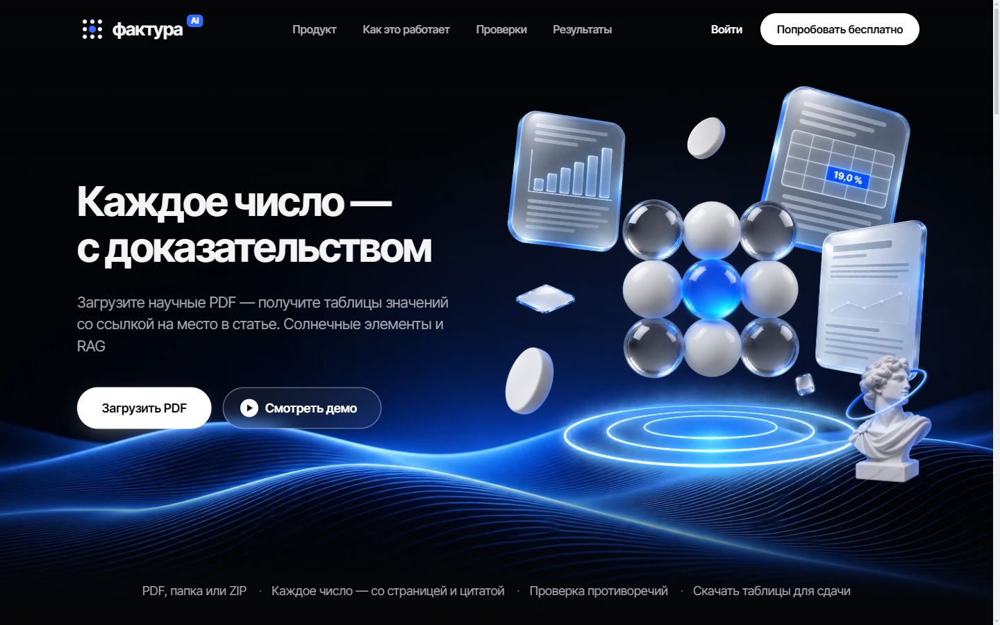
</p>

<h1 align="center">Фактура AI</h1>

<p align="center">
  <b>Каждое число — с доказательством.</b><br>
  Загружаете научные PDF и получаете таблицы набора данных в формате сдачи кейса.<br>
  У каждого значения есть страница статьи и дословная цитата, противоречия отмечены как замечания.
</p>

<p align="center">
  <a href="https://factura.t1nnld.com"><b>Открыть сайт</b></a> ·
  <a href="https://github.com/Nomadd-yas/faktura-ai">Бэкенд</a> ·
  <a href="#скриншоты">Скриншоты</a> ·
  <a href="#быстрый-старт">Быстрый старт</a>
</p>

<p align="center">
  
  
  
  
</p>

<table>
  <tr>
    <td width="33%" align="center"><b>1. Загрузите PDF</b><br><sub>Папка, ZIP или файлы, область выбирается сразу</sub></td>
    <td width="33%" align="center"><b>2. Получите таблицы</b><br><sub>7 таблиц шаблона, сводка и замечания</sub></td>
    <td width="33%" align="center"><b>3. Проверьте по статье</b><br><sub>Клик по числу — цитата подсвечена в PDF</sub></td>
  </tr>
  <tr>
    <td>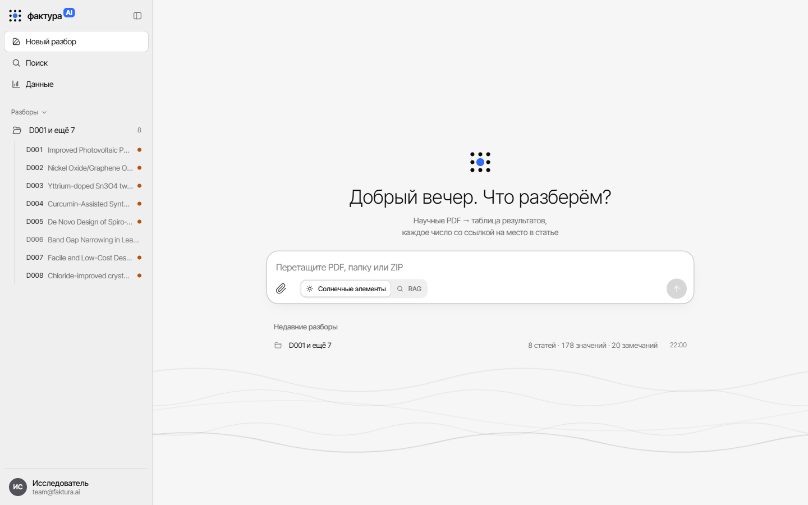</td>
    <td>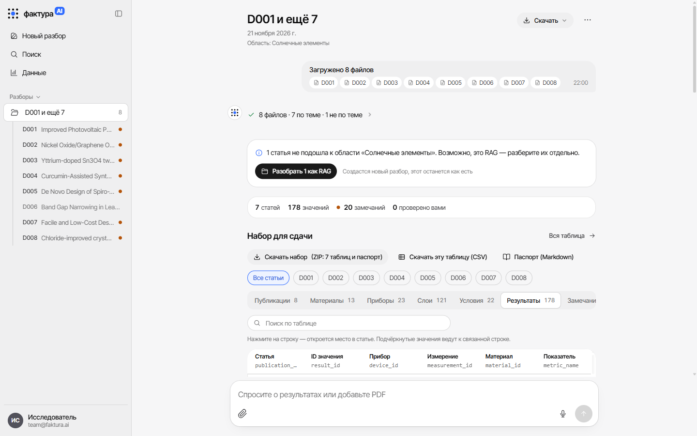</td>
    <td>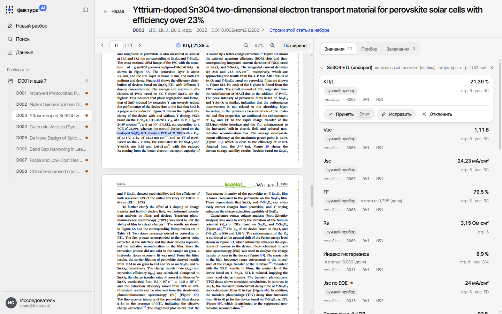</td>
  </tr>
</table>

Проект сделан для кейса 5 хакатона ВИНИТИ «Извлечение фактов из научных статей». В нём две предметные области:

| Область | Что извлекается | Таблицы набора |
|---|---|---|
| Тонкоплёночные солнечные элементы | 11 показателей: PCE, Voc, Jsc, FF, Rs, Rsh, HI, Jsc_EQE, stabilized_PCE, T80, retained_PCE | `publications`, `materials`, `devices`, `layers`, `measurements`, `results`, `issues` |
| RAG и поиск по документам | метрики качества (Answer F1, EM, NDCG@k…) по конфигурациям, датасетам, задачам и экспериментам | `publications`, `configurations`, `datasets`, `tasks`, `experiments`, `results`, `issues` |

## Возможности

### Загрузка и разбор
- PDF, папка или ZIP — перетаскиванием в любое место приложения или через скрепку.
- Область выбирается при загрузке: «Солнечные элементы» или «RAG» (на телефоне — выпадающим списком).
- Прогресс каждого файла и всего разбора, этап («Извлечение», «Нормализация», «Проверка») и примерное время до конца. С бэком ход разбора приходит потоком событий (SSE), при обрыве — опрос раз в 2 секунды.
- Статусы файлов: готово, не по теме (с причиной), нет данных, скан с OCR (с надёжностью распознавания), ошибка.
- Файлы можно догрузить в уже созданный разбор.
- Если статьи не подошли к области, сервис подсказывает «похоже на RAG» или «похоже на солнечные» — отмеченные статьи разбираются в другой области отдельным разбором, исходный не меняется.

### Разбор
- Лента разбора: загруженные файлы, сводка (статьи, значения, замечания), покрытие показателей по статьям, лучшие значения по каждому показателю, замечания по типам проверок.
- Набор для сдачи прямо в ленте: 7 таблиц с вкладками, фильтр по статье, поиск по таблице, массовое принятие и отклонение строк.
- Меню «Скачать»: набор для сдачи (ZIP), один файл JSON, файл Excel, паспорт в Markdown и JSON.
- Управление разбором: переименовать, закрепить, перезапустить, остановить, удалить (с подтверждением).
- Время и кнопка «Копировать» под сводкой и под каждым ответом.

### Статья
- PDF рядом со значениями: клик по числу открывает нужную страницу и подсвечивает дословную цитату.
- Значения сгруппированы по приборам и условиям измерения, видны повторы и ссылки на связанные строки (прибор, измерение, материал).
- Для RAG — конфигурации, датасеты, задачи и эксперименты, фильтры по метрике, конфигурации и датасету; десятки тысяч строк подгружаются постранично.
- Вкладка «Замечания» с переходом к месту в PDF.

### Правки и журнал
- Каждое значение можно принять, исправить (новое число) или отклонить. Отклонённые строки не попадают в набор, исправленные уходят с новым значением.
- Замечание можно отметить «Исправлено» или «Это не ошибка»; замечания закрываются и сами, когда исправлены все связанные значения.
- Журнал правок: все действия по дням, отмена любого действия и «Отменить последнее». С бэком журнал хранится на сервере и одинаков в любом браузере.

### Данные
- «Таблица» — те же 7 таблиц, что уходят на сдачу, с выбором статей и показателей.
- «Проверки» — замечания по группам: числа не сходятся (КПД ≠ Voc·Jsc·FF), противоречия в статье, единицы и округление, условия измерения.
- «Паспорт» — поля, типы, единицы, правила проверок, нормализация и критерии отбора; с бэком — тот же паспорт, что лежит в ZIP.
- «Экспорт» — предпросмотр всех таблиц, ZIP, JSON и Excel, набор по всем разборам сразу.

### Набор для сдачи
- ZIP с 7 CSV точно по шаблону кейса, `PASSPORT.md` и `passport.json`.
- С бэком сервер прогоняет официальный `check_submission.py`: итог проверки показывается после скачивания, при ошибках — с первой ошибкой и кнопкой «Скачать без проверки».
- Пока разбор идёт, можно скачать уже готовые статьи.

### Вопросы по разбору
- Спросите обычными словами: «лучший КПД перовскитов со слоем SnO2», «замечания у D001», «какие датасеты». Ответ — короткий текст и карточки со строками, каждое число со сноской на статью и страницу.
- Подсказки вопросов по данным разбора и голосовой ввод (Chrome, Edge).

### Словарь нормализации
- Синонимы показателей, материалов и условий измерения («КПД» = «PCE» = «η»), единицы и множители к основной единице.
- Свои синонимы добавляются и удаляются; с бэком хранятся на сервере и применяются к новым разборам.

### Удобство
- Поиск по разборам, статьям и значениям (Ctrl+K), горячие клавиши.
- Светлая и тёмная тема, адаптивная вёрстка для телефона.
- Единые скелетоны загрузки, уведомления с полоской до закрытия и кнопкой «Вернуть», подтверждение опасных действий.
- Ссылки на любое значение, статью и замечание открываются напрямую и после обновления страницы.

## Стек

Vue 3 (Composition API, `<script setup>`), TypeScript, Vite 7, Vue Router, pdf.js. Никаких UI-библиотек: дизайн-система своя, на CSS-токенах (`src/styles.css`).

## Быстрый старт

Нужен Node.js 20+.

```bash
npm install
cp .env.example .env
npm run dev          # http://localhost:5200
```

По умолчанию фронт работает **без бэкенда** (режим `mock`): разборы считаются в браузере на эталонной разметке dev, которую выдали организаторы. Это удобно, чтобы посмотреть интерфейс.

### PDF статей для мок-режима

Сами статьи в репозиторий не входят. Чтобы в мок-режиме открывались PDF, распакуйте архив участника кейса:

```bash
npm run corpus -- Кейс5_область1_участникам.zip   # PDF попадут в public/corpus/
```

## Подключение к бэкенду

Режим и адрес задаются в `.env`:

| Переменная | Значение |
|---|---|
| `VITE_DATA_SOURCE` | `mock` — данные в браузере; `api` — настоящий бэкенд |
| `VITE_API_URL` | путь к API для браузера, по умолчанию `/api/v1` |
| `VITE_API_PROXY` | куда дев-сервер Vite пересылает `/api`, например `http://127.0.0.1:8000` |

Порядок запуска:
1. Запустите [бэкенд](https://github.com/Nomadd-yas/faktura-ai) на `:8000`.
2. Поставьте `VITE_DATA_SOURCE=api` и перезапустите `npm run dev`.
3. Войдите: учётные записи выдаёт бэкенд, регистрации нет.

Дев-сервер проксирует `/api`, поэтому для браузера это один домен: CORS не нужен, refresh-cookie работает. На Windows для прокси лучше указывать `127.0.0.1`, а не `localhost`.

В режиме `api` всё работает через сервер: разборы, правки значений и отметки замечаний, журнал с отменой, вопросы по разбору, словарь нормализации, экспорт. Ход разбора приходит потоком событий (SSE). Данные на моках в этом режиме не подставляются.

Для проверки режима `api` без настоящего бэкенда есть маленький сервер на эталоне dev:

```bash
npm run mock-api     # :8000, вход admin@faktura.local / admin
```

## Сборка и деплой

```bash
npm run build        # проверка типов + сборка в dist/
npm run preview      # локальный просмотр сборки
```

`dist/` — статический сайт. На сервере:
- отдайте `index.html` на любой путь (SPA, history-режим);
- проксируйте `/api/` на бэкенд;
- переменные `VITE_*` задаются на этапе сборки.

## Команды

| Команда | Что делает |
|---|---|
| `npm run dev` | дев-сервер на `:5200` |
| `npm run build` | проверка типов и сборка |
| `npm run typecheck` | только проверка типов |
| `npm run data` | пересобрать данные мок-режима из `data/` |
| `npm run corpus -- <zip>` | распаковать PDF статей из архива участника |
| `npm run mock-api` | тестовый API на `:8000` |

## Структура

```
src/
  main.ts, App.vue      маршруты и оболочка приложения
  views/                экраны: лендинг, главная, разбор, статья, «Данные», настройки
  components/           компоненты и Ui*-примитивы (кнопки, загрузка, прогресс, таблицы)
  case/                 слой данных кейса: 7 таблиц, разборы, RAG, экспорт, подписи
  api/                  клиент API: токен и refresh, разборы, статьи, загрузка файлов
  passport.ts           паспорт набора: поля, типы, единицы, правила
  styles.css            токены и базовые стили
scripts/                генерация данных мок-режима, распаковка корпуса, тестовый API
data/
  solar/, rag/          эталонная разметка dev от организаторов (CSV) — источник данных мок-режима
```

## Формат сдачи

Набор — ровно 7 CSV по шаблону кейса:
- UTF-8 с BOM, разделитель — запятая, десятичная точка;
- логические значения — `true` / `false`, несколько значений через `;`;
- пустая ячейка значит «в статье этого нет».

Вместе с таблицами в архив кладётся паспорт набора: `PASSPORT.md` и `passport.json`.

## Скриншоты

<table>
  <tr>
    <td width="50%"><p align="center"><sub><b>Статья.</b> PDF с подсветкой цитаты, рядом значения: принять, исправить, отклонить</sub></p></td>
    <td width="50%">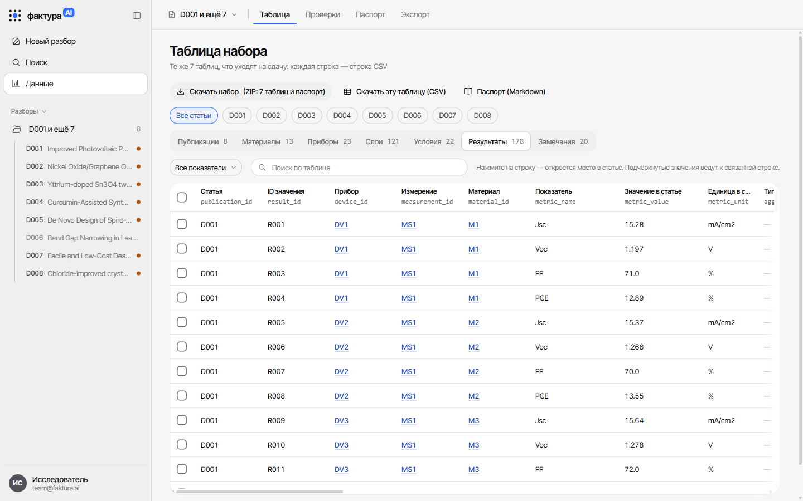<p align="center"><sub><b>Таблица набора.</b> Те же 7 таблиц, что уходят на сдачу</sub></p></td>
  </tr>
  <tr>
    <td>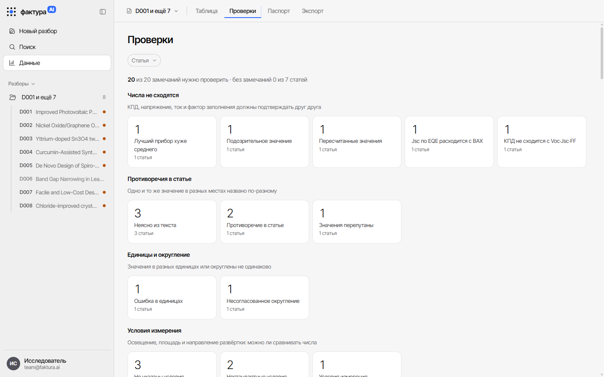<p align="center"><sub><b>Проверки.</b> Замечания по правилам: числа не сходятся, противоречия, единицы</sub></p></td>
    <td>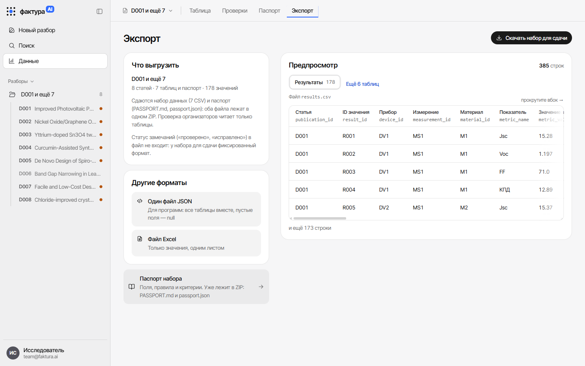<p align="center"><sub><b>Экспорт.</b> ZIP для сдачи, JSON, Excel и паспорт набора</sub></p></td>
  </tr>
  <tr>
    <td>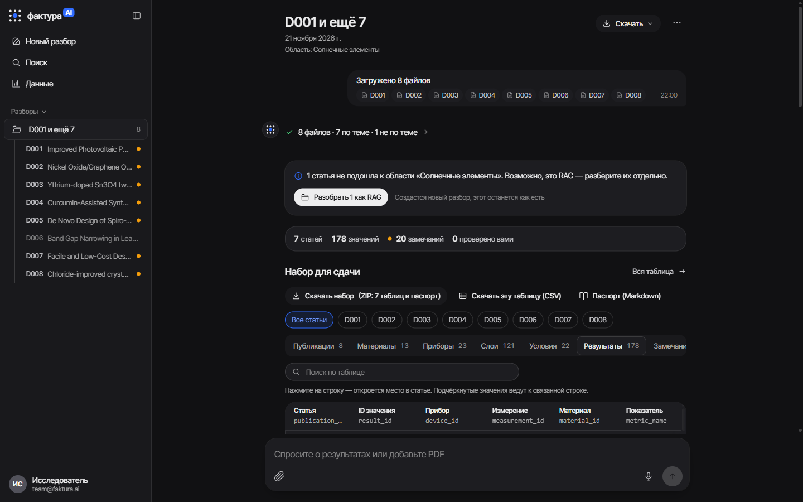<p align="center"><sub><b>Тёмная тема.</b> Переключается автоматически по системе</sub></p></td>
    <td>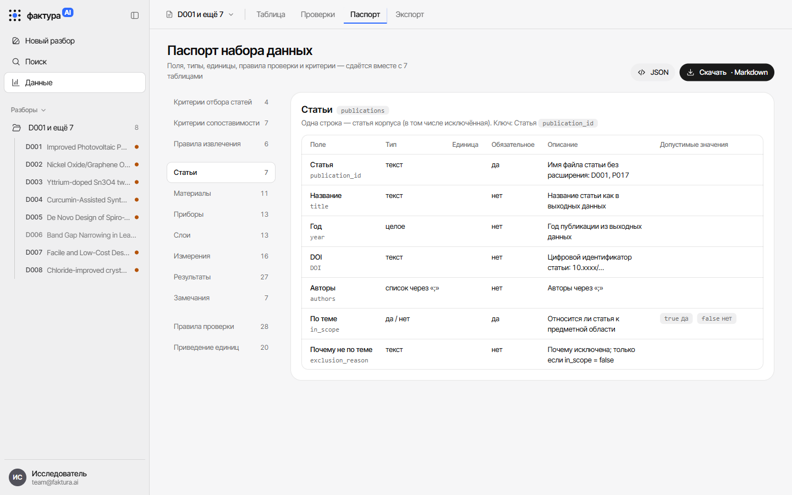<p align="center"><sub><b>Паспорт набора.</b> Поля, единицы, правила проверок и критерии отбора</sub></p></td>
  </tr>
</table>

<p align="center">
  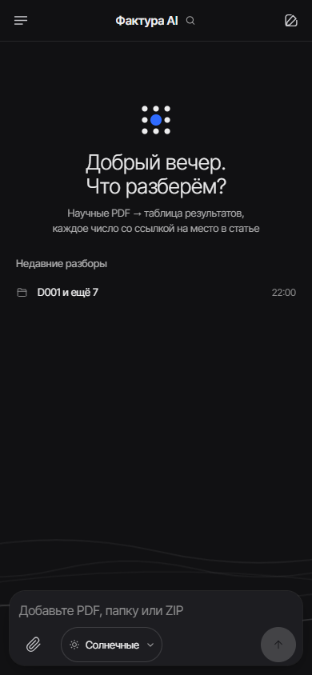
  &nbsp;
  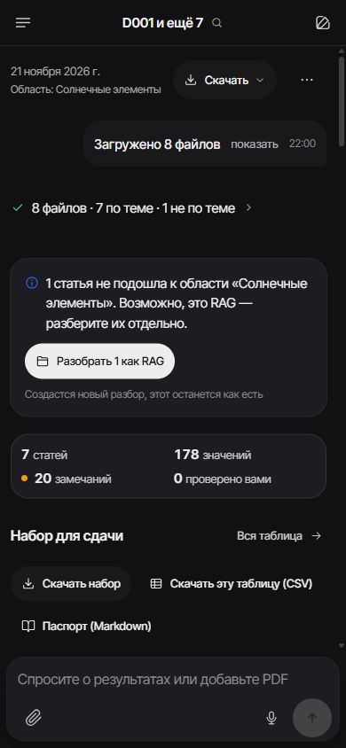
  &nbsp;
  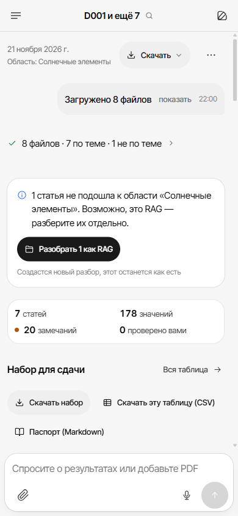
  <br><sub><b>На телефоне.</b> Та же работа с разборами, адаптивная вёрстка</sub>
</p>
